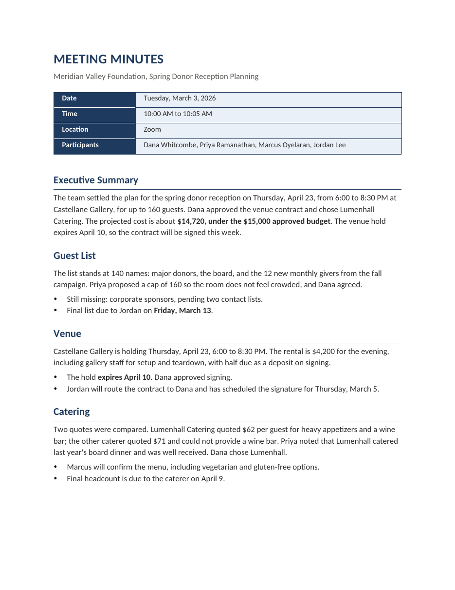

# Meeting minutes from a transcript

A Claude skill and a Python script that turn a meeting transcript into finished, formatted
minutes in Word. I'm Andrew Park, an executive assistant. I'm the only administrative staff
member in a college communications office, so the minutes are mine to write, and I built this
to write them faster without letting a wrong name reach the people who read them.

Drafting minutes by hand typically took me two to three hours. With this workflow, a Teams or
Zoom transcript that already has speaker labels becomes a finished draft in about 10 minutes.
A transcript that needs cleanup takes 20 to 30. Those are my own figures from doing the work,
not a timed study. The office's files hold 25 finished sets of minutes made with this workflow
and its earlier versions, from Teams and Zoom meetings, vendor calls, trainings, committee
meetings and in-person planning sessions.

Everything in this repository uses a fictional meeting. No real meeting, person or document is
included.



## How it works

The sample folder walks through one meeting from start to finish.

| Step | What happens | Sample file |
|---|---|---|
| 1. Transcript | A Teams or Zoom transcript, or a recording I transcribe on my own laptop | [`01_transcript.txt`](sample/01_transcript.txt) |
| 2. Name check | Claude flags every name it is unsure of and waits for me | [`02_name_check.md`](sample/02_name_check.md) |
| 3. Draft | Claude writes the minutes in a simple marked-up text format | [`03_minutes_input.txt`](sample/03_minutes_input.txt) |
| 4. Document | The script turns that text into a styled Word file | [`04_minutes.docx`](sample/04_minutes.docx), [PDF](sample/04_minutes.pdf) |
| 5. Finish | I read the draft and make final edits in Word before it goes out | |

Claude decides what the meeting said: the decisions, the owners, the deadlines. The script
decides how it looks. Keeping the formatting in code means every set of minutes comes out in
the same house style, and Claude never has to recreate a table border from memory.

## How the name check works

Speech-to-text gets uncommon names wrong more than anything else. In the sample, "Marcus
Oyelaran" comes through as "Marcus Oil Aaron" and the caterer "Lumenhall" as "Lumen Hall."
A misspelled name in minutes that go to an executive is the kind of error people remember.

Before drafting anything, Claude compares every name in the transcript against a list of the
people, vendors and places the office works with
([`known_names.md`](skill/minutes-builder/references/known_names.md)). Each near-miss, and each
name that isn't on the list, becomes one line:

```
[NAME CHECK] Transcript says "Marcus Oil Aaron". Possible match: Marcus Oyelaran (Events Coordinator). Correct?
[NAME CHECK] Transcript says "Teodora". Not on the list; no surname given. How should she appear in the minutes?
```

Then it stops. I confirm or correct each line, and only then does it write. It never swaps a
name on its own. The second line above shows why: there is no way for Claude to know the
student's surname, and a confident guess is worse than leaving it marked "to be confirmed."
When I confirm a new name, it goes on the list for the next meeting.

## What goes into the AI

I treat a prompt to a cloud model like a public forum unless I'm working in a secured
environment. Recordings with sensitive content are transcribed on my own laptop, so the audio
never leaves it. Recordings and transcripts are deleted on a schedule, and sensitive ones are
destroyed as soon as the minutes are made. No passwords or keys ever go into a prompt.

## How it was built

I designed the workflow and built it by directing Claude Code. It has been revised as real
meetings exposed problems. A few of those fixes:

- Section titles are real Word headings, so a screen reader and the PDF outline can navigate
  them. Early versions only looked like headings.
- Each document's title is the meeting's name, so a screen reader or a PDF title bar doesn't
  announce "Meeting Minutes" for every file.
- Tables line up with the text margin in every Word compatibility mode, not only the one the
  script was first tested in.

## Run it yourself

You need Python 3 and `python-docx`.

```bash
pip install python-docx
python3 scripts/generate_minutes_docx.py --input sample/03_minutes_input.txt --output my_minutes.docx
```

To use the full workflow with Claude, copy `skill/minutes-builder/` into your Claude skills
folder, replace the names in `references/known_names.md` with your own, and change the three
colour values at the top of the script to your organization's brand. Then give Claude a
transcript and ask for minutes.

## What's here

```
skill/minutes-builder/SKILL.md                 the instructions Claude follows
skill/minutes-builder/references/known_names.md  the names list used by the name check
scripts/generate_minutes_docx.py               text-to-Word generator (house style lives here)
sample/                                        one fictional meeting, transcript to finished minutes
docs/                                          page images of the sample minutes
```

Released under the MIT License.
